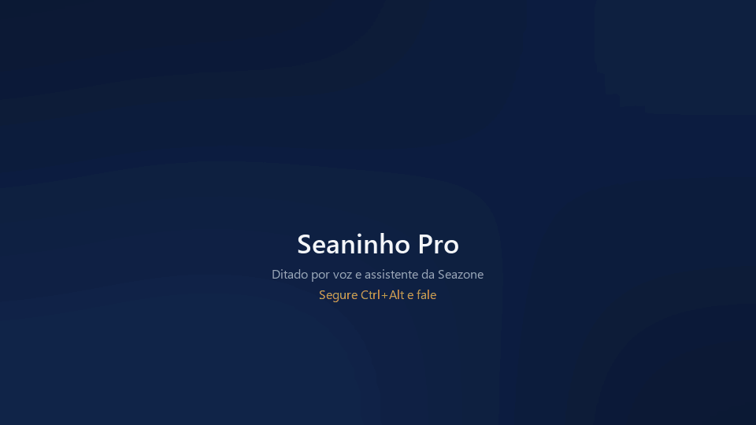

# Seaninho — distribuição

Os dois apps de voz da Seazone para Windows:

- **Seaninho Transcritor (básico):** ditado por voz. Segure `Ctrl+Alt`, fale, solte, e o texto aparece pronto
  onde o cursor estiver.
- **Seaninho Pro:** o ditado e mais um assistente de voz: agenda e lembretes de reunião, e-mails, Google Drive e
  planilhas, Slack, anotações e lembretes, pausas de saúde, histórico de cópias e prints (`Ctrl+Alt+V`), "responde
  essa conversa", pesquisa rápida, sites da Seazone e os dados da empresa (Taskdex, Nekt, base de conhecimento).



O código-fonte fica em repositórios privados. Aqui ficam só o instalador e os executáveis publicados, para
qualquer pessoa baixar sem login.

## Instalar (o jeito mais fácil: com o Claude)

Cole no Claude (Claude Code ou o app do Claude no computador):

> Instale o Seaninho para mim seguindo https://raw.githubusercontent.com/seazone-tech/seaninho-transcritor-dist/main/INSTALAR_COM_CLAUDE.md

O Claude pergunta se você quer o básico ou o Pro, instala e, no Pro, configura tudo: abre a janela do Seaninho
para você colar sua chave de IA da Seazone (ela não passa pelo chat), conecta sua conta Google e confere quais
sistemas da Seazone você pode consultar por voz.

## Atualizar o Pro (com o Claude)

A partir da 1.6.12, o Seaninho Pro se atualiza sozinho toda vez que abre. Quem está numa versão anterior (ou viu o
Seaninho pedir a chave de novo depois de reiniciar, corrigido na 1.6.13.1) cola no Claude:

> Atualize o meu Seaninho Pro seguindo https://raw.githubusercontent.com/seazone-tech/seaninho-transcritor-dist/main/ATUALIZAR_COM_CLAUDE.md

O Claude guarda um diagnóstico na Área de Trabalho, atualiza sem mexer na chave nem nas configurações e confere se
ficou tudo certo.

## Instalar sem o Claude

No PowerShell (não precisa de administrador):

```powershell
irm https://raw.githubusercontent.com/seazone-tech/seaninho-transcritor-dist/main/install.ps1 | iex
```

Uma janela pergunta: **Sim** = Seaninho Pro, **Não** = Seaninho Transcritor (básico). O instalador baixa a
versão escolhida para `%LOCALAPPDATA%\Programs\`, cria o atalho no Menu Iniciar, liga "Iniciar com o Windows" e
abre o app. Se o básico já estiver instalado e você escolher o Pro, ele pergunta se troca (a chave, o dicionário e
o histórico vão junto).

Na primeira abertura o app pede **sua chave de IA da Seazone** (https://ai-portal.seazone.com.br › Nova key,
começa com `sk-`). Cada pessoa usa a própria chave.

O **Pro se atualiza sozinho** (a partir da 1.6.12): toda vez que abre, confere aqui se saiu uma versão nova e
já instala. O básico se atualiza rodando o mesmo comando de novo. Suas configurações ficam em
`%APPDATA%\SeaninhoTranscritor` ou `%APPDATA%\SeaninhoPro` e não são apagadas.

## Releases

- Básico: releases `v*` (a "latest" é sempre o básico, para o instalador antigo continuar funcionando).
- Pro: releases `pro-v*`, com o `SeaninhoPro.exe`. O app e o instalador pegam a de maior versão e ignoram
  pré-releases (servem para testar antes de mandar para todo mundo).

Se o Windows SmartScreen avisar, clique em "Mais informações" › "Executar assim mesmo" (os executáveis não são
assinados).
